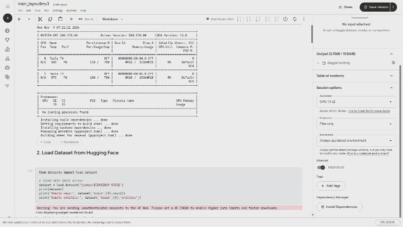

# DocuExtract — Document AI Invoice & Receipt Key Information Extraction

[](https://github.com/lalithtrs/LayoutParse/actions/workflows/ci.yml)
[](https://www.python.org/downloads/)
[](https://opensource.org/licenses/Apache-2.0)
[](https://www.docker.com/)
[](https://fastapi.tiangolo.com/)

An end-to-end Document AI system that turns a scanned invoice/receipt image into structured
accounting data. It combines **PaddleOCR** (text detection + recognition) with a fine-tuned
**LayoutLMv3** (visual + spatial + textual token classification) to extract four key fields —
`company`, `date`, `address`, `total` — as schema-validated JSON with per-field confidence, served
behind a FastAPI API with Docker, CI/CD, and drift monitoring.

---

## 🎥 Demo



*Uploading a receipt to the `/extract` endpoint and getting structured key fields back with
per-field confidence scores.*

> A temporary demo instance may be running at `http://54.206.197.50:8000/docs` (Swagger) /
> `http://54.206.197.50:8000/telemetry`. It is a personal spot instance and may be offline — the
> reliable way to run the system is the **local** quickstart below.

---

## 1. Results (SROIE ICDAR 2019)

Fine-tuned `microsoft/layoutlmv3-base`, evaluated on the held-out **SROIE test split (361 real
receipts)**. Metrics are **entity-level F1 (seqeval)** for key information extraction.

| Field | F1 |
| :--- | :---: |
| Date | 0.976 |
| Company | 0.930 |
| Total | 0.868 |
| Address | 0.759 |
| **Overall (micro) F1** | **0.894** |

Address is the weakest field — it is the hardest to align to OCR tokens (multi-line, commas,
abbreviations, OCR noise), which is reflected honestly above. Numbers are reproducible locally
(see §5); your run may vary by a point or two with the train/val split and seed.

---

## 2. System architecture

```text
  Scanned receipt image (JPG / PNG)
                │
                ▼
  [OCR]        PaddleOCR  →  word tokens + bounding boxes
                │
                ▼
  [Features]   box normalization [0–1000] + word→sub-token alignment
                │
                ▼
  [Model]      fine-tuned LayoutLMv3 (image patches + boxes + text)  →  per-token BIO labels
                │
                ▼
  [Post-proc]  BIO chunk aggregation + date (ISO) & total normalization + confidence
                │
                ▼
  [API]        FastAPI  POST /extract  →  structured JSON + confidence + drift telemetry
```

During **training and evaluation**, SROIE's ground-truth OCR boxes are used (isolated KIE). In
**production**, PaddleOCR supplies the boxes end-to-end; OCR errors on noisy receipts add some
degradation on top of the numbers above.

---

## 3. MLOps & engineering

- **Reproducible training** — `scripts/train.py` (and the self-contained
  `notebooks/01_train_layoutlmv3.ipynb`) fine-tune LayoutLMv3 on SROIE with word-level BIO tagging,
  then save the model **and** processor.
- **Experiment tracking** — `scripts/log_experiment_to_mlflow.py` logs hyperparameters, loss curves,
  and per-field F1 to MLflow.
- **Serving** — FastAPI (`/extract`, `/health`, `/telemetry`) with Pydantic schemas and per-field
  confidence scores.
- **Containerized** — CPU-only Docker image (`docker/Dockerfile`) to keep the serving footprint small.
- **CI/CD** — GitHub Actions: Ruff lint + unit tests + Docker build (`.github/workflows/ci.yml`),
  and build/push to AWS ECR on tags (`.github/workflows/cd.yml`).
- **Monitoring** — `/telemetry` exposes request counts, latency, and a low-confidence/drift signal
  (`src/api/monitoring.py`).

```text
 [Ingestion] → [Feature eng.] → [Training] → [CI/CD & tests] → [Serving] → [Observability]
  SROIE HF      word-level BIO    LayoutLMv3    GitHub Actions    FastAPI      drift telemetry
  loader        + box norm        + MLflow      Ruff + pytest     + Docker     (/telemetry)
```

---

## 4. Repository structure

```text
├── configs/            # base / train / infer YAML configs
├── data/
│   ├── samples/        # 5 real SROIE receipts (images + box + key)  [committed]
│   └── test/           # full 361-receipt benchmark  [regenerated locally, git-ignored]
├── docker/             # Dockerfile + docker-compose (FastAPI + MLflow)
├── notebooks/          # 01_train_layoutlmv3.ipynb (self-contained Colab/Kaggle training)
├── scripts/            # download_data, train, evaluate, mlflow logging, drift sim
├── src/
│   ├── api/            # FastAPI app, schemas, drift telemetry
│   ├── data/           # bbox transforms, BIO tagger, prepare, dataset loader
│   ├── models/         # postprocessor, optional GenAI validator
│   ├── ocr/            # PaddleOCR + SROIE precomputed OCR engines
│   └── pipeline/       # end-to-end DocumentExtractor
├── tests/              # unit & integration tests
└── pyproject.toml
```

---

## 5. Quickstart (local)

```bash
git clone https://github.com/lalithtrs/LayoutParse.git
cd LayoutParse
python3 -m venv .venv && source .venv/bin/activate
pip install -r requirements.txt
```

**Get the model weights.** Train it (see §6) and unzip the checkpoint into
`models/best_layoutlmv3_sroie/`, or run `python scripts/setup_weights.py` if you have them hosted.

**Reproduce the benchmark numbers** on the real SROIE test set:

```bash
# Build the 361-receipt test set from Hugging Face (images + boxes + keys)
python scripts/download_data.py --source hf --split test --output-dir data/test

# Evaluate the fine-tuned model (isolated KIE with ground-truth OCR boxes)
python scripts/evaluate.py --data-dir data/test --ocr-engine sroie_precomputed
```

**Run the API locally:**

```bash
uvicorn src.api.app:app --host 0.0.0.0 --port 8000 --reload
# Swagger UI at http://localhost:8000/docs
curl -X POST "http://localhost:8000/extract?ocr_engine=paddle" \
     -F "file=@data/samples/images/X00016469670.jpg"
```

**Run the tests:**

```bash
pytest tests/
```

---

## 6. Training (GPU)

The model is fine-tuned on a GPU (Colab or Kaggle T4), then served on CPU.

1. Open `notebooks/01_train_layoutlmv3.ipynb` on [Colab](https://colab.research.google.com/) or Kaggle.
2. Set the runtime to **GPU (T4)** and **Run all** (~30–60 min for 10 epochs).
3. It streams SROIE from Hugging Face, tokenizes **word-level** with a robust BIO tagger
   (so all four fields — including multi-word Company/Address — are learned), fine-tunes
   `microsoft/layoutlmv3-base`, prints per-field F1, and saves `best_layoutlmv3_sroie.zip`.
4. Unzip it into `models/best_layoutlmv3_sroie/` and re-run the evaluation in §5.

Equivalent CLI: `python scripts/train.py --config configs/train_config.yaml`.

---

## 7. API reference

**`POST /extract`** — upload a receipt image, get structured fields back:

```json
{
  "status": "success",
  "processing_time_ms": 1890.2,
  "data": {
    "company": {"value": "OJC MARKETING SDN BHD", "raw_value": "OJC MARKETING SDN BHD", "confidence": 0.95},
    "date":    {"value": "2019-01-15", "raw_value": "15/01/2019", "confidence": 0.98},
    "address": {"value": "NO 2 & 4 JALAN BAYU 4 BANDAR SERI ALAM 81750 MASAI JOHOR", "confidence": 0.88},
    "total":   {"value": "193.00", "raw_value": "RM 193.00", "confidence": 0.94}
  },
  "overall_confidence": 0.94,
  "warnings": []
}
```

`GET /health` — model/OCR readiness. `GET /telemetry` — request, latency, and drift stats.

---

## 8. Limitations

1. **Address is the weakest field (F1 ≈ 0.76).** Multi-line addresses with commas and OCR noise are
   hard to align to tokens; a share of receipts get partial address labels.
2. **End-to-end OCR degradation.** Reported numbers use ground-truth OCR boxes. With live PaddleOCR
   on noisy/thermal receipts, misreads and box skew reduce accuracy versus the isolated numbers.
3. **512-token limit.** Very long receipts (many line items) exceed LayoutLMv3's positional limit and
   would need sliding-window chunking.
4. **Key-value only.** The model targets `company / date / address / total`, not full line-item tables.

---

## 9. License

Apache 2.0. The SROIE dataset is distributed under CC BY 4.0.
